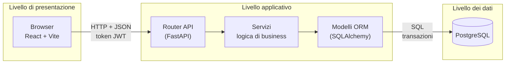
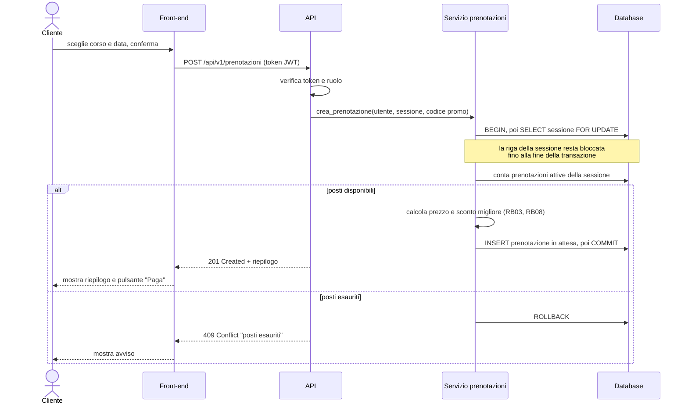

# Architettura del sistema

La piattaforma adotta un'architettura **client-server a tre livelli**. Ogni livello gira in un proprio
container Docker e comunica con quello adiacente attraverso un'interfaccia ben definita: il browser non
accede mai direttamente al database, ma passa sempre dalle API del back-end.

Per spiegare questa architettura mi è venuto naturale pensare alla bottega stessa e a cosa cercherebbe un eventuale visitatore o cliente: la struttura del sito permette di avere una visione completa di ciò che offre, spiegarne il contenuto, indirizzarlo alla prenotazione e al pagamento finale. Il sito funziona ed è molto intuitivo e chiaro. Una sua evoluzione futura potrebbe essere quella di avere una propria app, che sarebbe ancora più immediata per un pubblico giovanile e potrebbe aiutare la creazione di una community artistica, predisposta alla condivisione e alla crescita. Grazie ai livelli separati, l'app potrebbe usare lo stesso server e lo stesso database del sito.

## Responsabilità dei livelli

| Livello | Componente | Responsabilità |
| --- | --- | --- |
| Presentazione | React | Mostra vetrina, catalogo, area personale e pannello admin; invia richieste alle API e ne visualizza le risposte |
| Applicativo | Router (`app/routers`) | Riceve le richieste HTTP, valida i dati in ingresso con Pydantic, controlla autenticazione e ruolo |
| Applicativo | Servizi (`app/services`) | Applica le regole di business: capienza, sconti, cancellazioni, ingressi della membership |
| Applicativo | Modelli (`app/models`) | Traducono le tabelle del database in classi Python (mappatura oggetto-relazionale) |
| Dati | PostgreSQL | Memorizza i dati in modo persistente e garantisce integrità tramite vincoli e transazioni |

Separare router, servizi e modelli segue il principio di **separazione delle responsabilità**: una regola di
business (ad esempio lo sconto Under 26) vive in un solo punto del codice ed è testabile senza passare dal web.

## Elaborazione, memorizzazione e comunicazione

La traccia chiede di collegare il progetto ai concetti di architettura dei calcolatori. Le tre funzioni
fondamentali di un elaboratore si ritrovano nei tre livelli del sistema:

| Funzione | Dove avviene | Scelta progettuale |
| --- | --- | --- |
| **Elaborazione** | Back-end FastAPI, eseguito dal server ASGI Uvicorn | Gestione asincrona delle richieste: mentre una richiesta attende il database, il processore ne serve altre |
| **Memorizzazione** | PostgreSQL su volume Docker persistente | Dati su disco con indici sulle colonne più cercate; i prezzi sono salvati in **centesimi interi** perché la rappresentazione in virgola mobile introdurrebbe errori di arrotondamento |
| **Comunicazione** | HTTP tra browser e API, protocollo PostgreSQL tra API e database | Messaggi JSON leggeri e senza stato (stateless): ogni richiesta porta con sé il token che identifica l'utente |

## Flusso di una prenotazione

Il diagramma di sequenza mostra cosa accade quando un cliente prenota una data. È il caso più delicato,
perché due persone potrebbero contendersi l'ultimo posto nello stesso istante.

Il blocco della riga (`SELECT ... FOR UPDATE`) serializza le prenotazioni concorrenti sulla stessa sessione:
la seconda richiesta attende che la prima termini e trova il conteggio aggiornato. In questo modo la
capienza non può mai essere superata (RB01, RNF07).

Dopo la creazione, la prenotazione cambia stato con il pagamento, l'annullamento o la riattivazione:
il percorso completo è descritto nel [diagramma degli stati della prenotazione](diagrammi/stati-prenotazione.md).

## Sicurezza

| Aspetto | Soluzione |
| --- | --- |
| Password | Mai salvate in chiaro: solo l'hash bcrypt con sale casuale |
| Autenticazione | Token JWT firmato, con scadenza, inviato nell'intestazione `Authorization: Bearer` |
| Autorizzazione | Ogni endpoint dichiara il ruolo richiesto (cliente o amministratore) |
| Validazione | Tutti i dati in ingresso sono validati con schemi Pydantic prima di toccare il database |
| SQL injection | Query costruite dall'ORM con parametri, mai concatenando stringhe |
| Segreti | Chiavi e password del database nel file `.env`, escluso da Git |
| CORS | Il back-end accetta richieste solo dall'origine del front-end |
