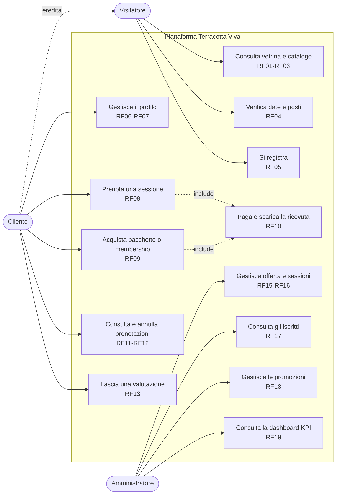

# Casi d'uso

Il diagramma riassume chi fa cosa sulla piattaforma. Il Cliente eredita tutto ciò che può fare il
Visitatore; l'Amministratore ha un'area separata. I codici fra parentesi rimandano ai requisiti
in [requisiti.md](../requisiti.md).

## Specifica dei casi d'uso principali

### UC5 – Prenota una sessione

| Voce | Descrizione |
| --- | --- |
| Attore | Cliente |
| Precondizioni | Il cliente ha effettuato l'accesso; la sessione è futura e ha posti liberi |
| Flusso principale | 1. Il cliente sceglie un corso o un'esperienza dal catalogo. 2. Seleziona una data disponibile. 3. Il sistema mostra il riepilogo con il prezzo, già scontato se si applica la promo Under 26 (RB03). 4. Il cliente conferma. 5. Il sistema registra la prenotazione nello stato "in attesa di pagamento" e scala un posto. 6. Il cliente paga (UC7) e la prenotazione passa a "confermata". |
| Flussi alternativi | 3a. Il cliente inserisce un codice promo: il sistema applica lo sconto più vantaggioso (RB08). 5a. Nel frattempo i posti sono finiti: il sistema avvisa e non registra nulla (RB01). 5b. Il cliente è già iscritto a quella sessione: il sistema rifiuta la richiesta (RB02). |
| Postcondizioni | La prenotazione compare nell'area personale del cliente e nell'elenco iscritti dell'amministratore |

### UC6 – Acquista pacchetto o membership

| Voce | Descrizione |
| --- | --- |
| Attore | Cliente |
| Precondizioni | Il cliente ha effettuato l'accesso |
| Flusso principale | 1. Il cliente sceglie un pacchetto (es. "Giornata in bottega") o una membership di coworking. 2. Il sistema mostra prezzo, contenuto e validità. 3. Il cliente conferma e paga (UC7). 4. Per una membership, il sistema attiva il contatore degli ingressi e la data di scadenza (RB06). |
| Flussi alternativi | 3a. Il pagamento simulato non va a buon fine: l'acquisto resta "in attesa" e il cliente può riprovare. |
| Postcondizioni | Il pacchetto o la membership compare nell'area personale con gli ingressi residui |

### UC13 – Consulta la dashboard KPI

| Voce | Descrizione |
| --- | --- |
| Attore | Amministratore |
| Precondizioni | L'utente ha effettuato l'accesso con ruolo amministratore |
| Flusso principale | 1. L'amministratore apre la dashboard. 2. Il sistema calcola e mostra: prenotazioni del periodo, tasso di riempimento medio delle sessioni, incassi simulati per tipologia di servizio, membership attive, valutazione media. 3. L'amministratore può cambiare il periodo di riferimento. |
| Postcondizioni | Nessuna modifica ai dati: la dashboard è di sola lettura |
