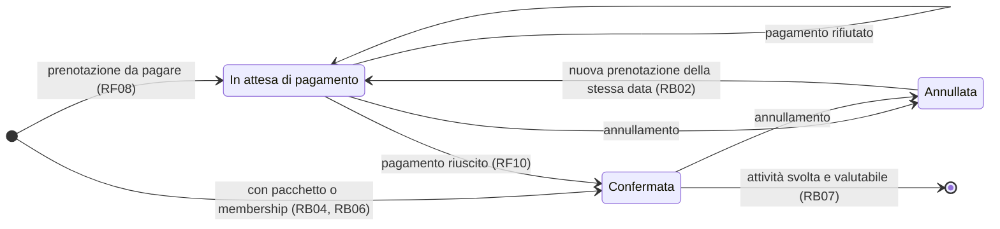

# Stati di una prenotazione

Il diagramma di macchina a stati mostra la vita di una prenotazione: in quali stati può trovarsi
e quali eventi la fanno passare da uno all'altro. Gli stati sono gli stessi dell'enumerazione
`StatoPrenotazione` nel back-end (`backend/app/models/enumerazioni.py`); le regole sono quelle
di `backend/app/services/transazioni.py` e `backend/app/services/catalogo.py`. I codici fra
parentesi rimandano ai requisiti e alle regole di business in [requisiti.md](../requisiti.md).

## Come leggere il diagramma

| Stato | Significato | Occupa un posto? |
| --- | --- | --- |
| In attesa di pagamento | Il posto è riservato, ma il pagamento non è ancora riuscito | Sì |
| Confermata | Il pagamento è riuscito, oppure la prenotazione è coperta da un pacchetto o da una membership | Sì |
| Annullata | Il cliente o la titolare hanno annullato: il posto torna libero | No |

Alcune regole che il diagramma rende visibili:

- **Il posto si conta subito.** Una prenotazione in attesa occupa già un posto: chi sta pagando non
  rischia di vederselo prendere da un altro cliente. È anche un limite del prototipo, descritto nel
  report: una prenotazione mai pagata tiene il posto senza scadenza.
- **Un pagamento rifiutato non cambia lo stato.** Il tentativo viene registrato con il suo codice
  di ricevuta e il cliente può riprovare.
- **L'annullamento ha due origini.** Il cliente può annullare fino a 48 ore prima dell'inizio
  (RB05); la titolare può annullare un'intera data, e allora tutte le sue prenotazioni attive passano
  ad annullata. In entrambi i casi l'ingresso della membership eventualmente usato viene restituito.
- **Si può tornare indietro.** Il vincolo di unicità cliente-data (RB02) non permette una seconda
  riga per la stessa data: se il cliente ci ripensa, la prenotazione annullata viene riattivata,
  in attesa di pagamento oppure subito confermata se coperta da un pacchetto o da una membership.
- **La valutazione arriva dopo.** Solo una prenotazione confermata, a lezione conclusa, può essere
  valutata, e una sola volta.
