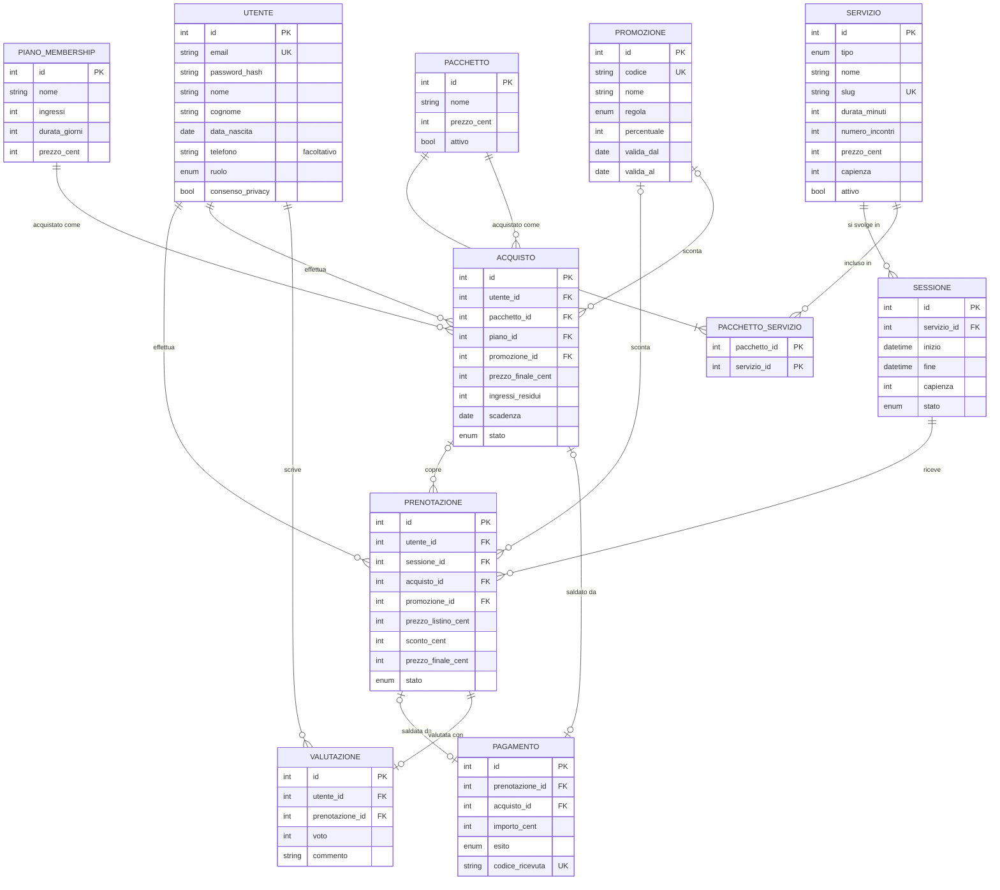

# Modello dei dati

Il database relazionale è composto da 11 tabelle. Il diagramma entità-relazione mostra le entità
principali e le loro relazioni; sotto, per ogni tabella, i campi e i vincoli che traducono in pratica
le regole di business di [requisiti.md](requisiti.md).

## Scelte di modellazione

- **Servizio e sessione sono separati.** Il servizio descrive *cosa* si offre (il corso di tornio, con il suo
  prezzo); la sessione descrive *quando* si svolge, con la propria capienza. Così lo stesso corso può avere
  molte date senza duplicare le informazioni.
- **I prezzi sono interi in centesimi** (`34000` = 340,00 €). I numeri in virgola mobile non rappresentano
  esattamente valori come 0,1, e sommando molti importi gli errori si accumulano.
- **La prenotazione conserva il prezzo pagato.** Listino, sconto e prezzo finale vengono copiati al momento
  della prenotazione: se in futuro il listino cambia, lo storico resta corretto.
- **Pacchetti e membership confluiscono in `ACQUISTO`.** Un acquisto si riferisce a un pacchetto *oppure* a un
  piano di membership (vincolo `CHECK`). Le prenotazioni coperte da un acquisto hanno `acquisto_id` valorizzato
  e prezzo zero; per la membership ogni prenotazione scala un ingresso (RB06).
- **Il pagamento salda una prenotazione o un acquisto**, mai entrambi (vincolo `CHECK`). Il pagamento è
  simulato, ma la struttura è pronta per un gateway reale.
- **Lo schema è in terza forma normale**: ogni informazione è memorizzata una sola volta, e la relazione molti
  a molti tra pacchetti e servizi passa dalla tabella ponte `PACCHETTO_SERVIZIO`.

## Vincoli di integrità

| Vincolo | Tabella | Regola garantita |
| --- | --- | --- |
| `UNIQUE (email)` | utenti | Un account per indirizzo email |
| `UNIQUE (utente_id, sessione_id)` | prenotazioni | Nessuna doppia prenotazione della stessa data (RB02) |
| `UNIQUE (prenotazione_id)` | valutazioni | Una sola valutazione per attività svolta (RB07) |
| `CHECK (voto BETWEEN 1 AND 5)` | valutazioni | Voto su scala da 1 a 5 |
| `CHECK (prezzo_cent >= 0)` | servizi, pacchetti, piani | Nessun prezzo negativo |
| `CHECK (num_nonnulls(pacchetto_id, piano_id) = 1)` | acquisti | Un acquisto riguarda un solo prodotto |
| `CHECK (num_nonnulls(prenotazione_id, acquisto_id) = 1)` | pagamenti | Un pagamento salda una sola cosa |
| `ON DELETE RESTRICT` | tutte le chiavi esterne | Non si cancella un servizio che ha prenotazioni |
| Transazione con `SELECT ... FOR UPDATE` | sessioni | La capienza non viene mai superata (RB01) |

## Valori ammessi (enumerazioni)

| Campo | Valori |
| --- | --- |
| `utenti.ruolo` | `cliente`, `admin` |
| `servizi.tipo` | `corso`, `esperienza`, `coworking` |
| `sessioni.stato` | `programmata`, `annullata` |
| `prenotazioni.stato` | `in_attesa`, `confermata`, `annullata` |
| `acquisti.stato` | `in_attesa`, `attivo`, `scaduto` |
| `pagamenti.esito` | `riuscito`, `fallito` |
| `promozioni.regola` | `codice` (serve un codice), `under26` (automatica in base all'età) |
