# Scenari di test funzionale

Dopo la costruzione del sito, ho voluto simulare personalmente un possibile uso quotidiano di un visitatore che entra per la prima volta, ritrovandosi in questa home piena di colore, con l'iniziativa under 26 e le varie sezioni a seguire. Si può visionare un pacchetto, un'esperienza o diventare un member della bottega sfruttandone tutti i suoi vantaggi. Anche l'accesso come titolare è risultato funzionante ed esaustivo, con tutti i dati necessari al monitoraggio dell'attività. L'esperienza in prima persona è stata soddisfacente soprattutto usando uno smartphone, quindi massima portabilità.

Le prove sono state eseguite il 9 novembre 2026 sul prototipo avviato con Docker, partendo da un
database vuoto in cui sono stati caricati solo i dati della bottega (`python -m app.seed`) e i dati
dimostrativi (`python -m app.demo`). Tutte le persone che compaiono sono inventate. Le prove da
computer sono state fatte con Chrome su macOS, quelle da smartphone con Safari su iPhone, collegato
al computer attraverso la rete di casa. I codici fra parentesi rimandano ai requisiti e alle regole
di business in [requisiti.md](requisiti.md).

Questi scenari verificano il sistema dal punto di vista di chi lo usa. Si affiancano ai test
automatici del back-end (71) e del front-end (21), che controllano il codice e si eseguono con i
comandi indicati nel [README](../README.md).

## Riepilogo

| # | Scenario | Utente | Esito |
| --- | --- | --- | --- |
| 1 | Consultare la vetrina e il catalogo | Visitatore | Superato |
| 2 | Registrazione rifiutata sotto i 14 anni | Visitatore | Superato |
| 3 | Prenotare con lo sconto Under 26 e pagare | Giulia (cliente) | Superato |
| 4 | Pagamento rifiutato | Luca (cliente) | Superato |
| 5 | Prenotare con un pacchetto | Marco (cliente) | Superato |
| 6 | Prenotare il coworking con la membership | Sara (cliente) | Superato |
| 7 | Consultare la dashboard | Titolare | Superato |
| 8 | Consultare gli iscritti di una data | Titolare | Superato |
| 9 | Usare il sito dallo smartphone | Giulia (cliente) | Superato |

## 1. Consultare la vetrina e il catalogo

**Utente:** visitatore, senza account. **Requisiti:** RF01, RF02, RF04.

**Passi**
1. Aprire la home del sito.
2. Scegliere *Esperienza giornaliera – tornio* dal catalogo.
3. Scorrere fino alle date e alle recensioni.

**Risultato atteso:** la vetrina presenta la bottega, la sua filosofia e lo sconto per i giovani.
La scheda mostra durata, prezzo e capienza, le date future con i posti ancora liberi e le recensioni
dei clienti con il solo nome di battesimo. Per prenotare viene chiesto di accedere o di registrarsi.

**Risultato ottenuto:** come atteso. La prima data mostra 4 posti liberi su 6, perché due posti sono
già prenotati; il voto medio è 4,5 su 5 da 2 recensioni.

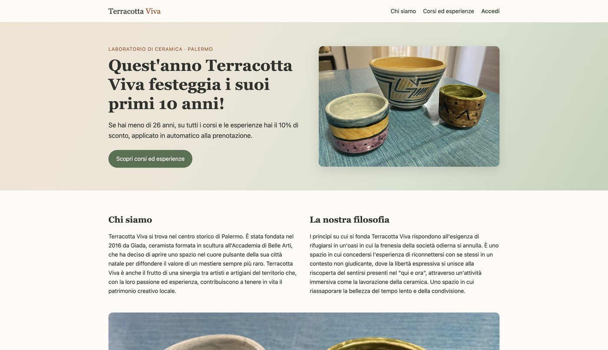
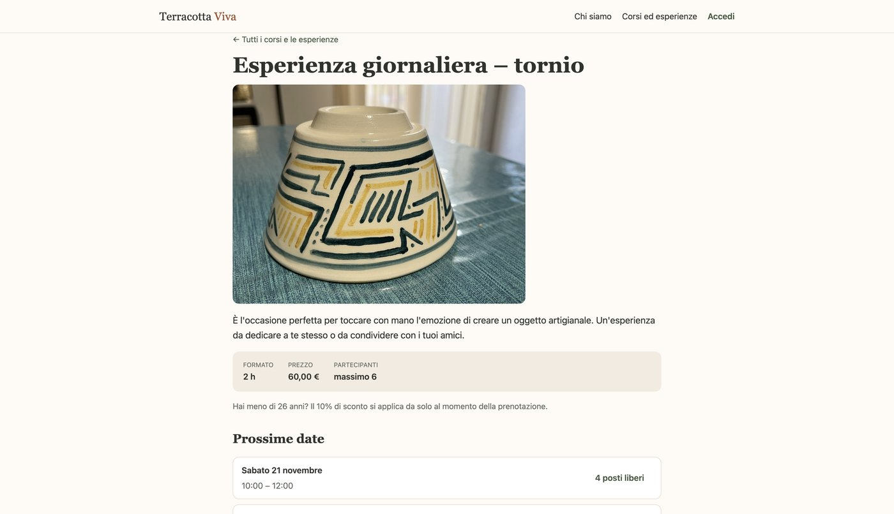
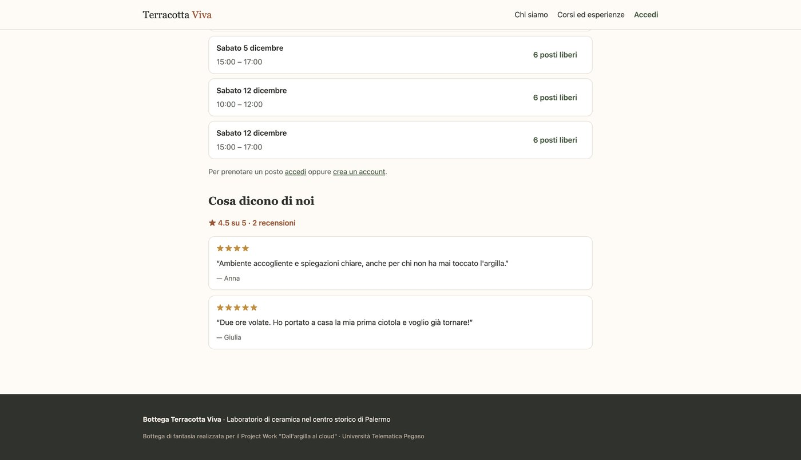

## 2. Registrazione rifiutata sotto i 14 anni

**Utente:** visitatore. **Requisiti:** RF05, RNF02 (privacy).

**Passi**
1. Aprire *Crea il tuo account*.
2. Compilare il modulo con una data di nascita del 2013, dare il consenso al trattamento dei dati e
   premere *Registrati*.

**Risultato atteso:** la registrazione viene rifiutata, perché in Italia servono almeno 14 anni per
prestare da soli il consenso ai servizi online.

**Risultato ottenuto:** come atteso. Compare il messaggio "Per registrarsi servono almeno 14 anni" e
l'account non viene creato.

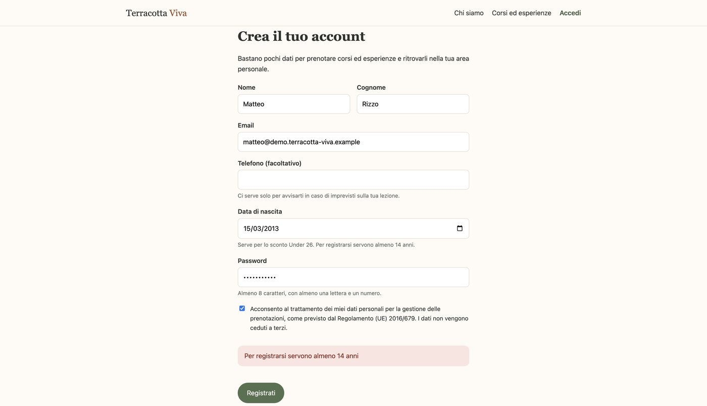

## 3. Prenotare con lo sconto Under 26 e pagare

**Utente:** Giulia, 23 anni. **Requisiti:** RF08, RF10, RB03.

**Passi**
1. Accedere come Giulia e aprire *Esperienza giornaliera – tornio*.
2. Premere *Prenota* su una data libera.
3. Premere *Paga* e aprire la ricevuta.

**Risultato atteso:** il prezzo di listino viene scontato del 10% in automatico, senza inserire
codici. Dopo il pagamento la prenotazione è confermata e la ricevuta riporta codice, intestataria,
attività, data e importo.

**Risultato ottenuto:** come atteso. Listino 60,00 €, sconto *Giovani in bottega* −6,00 €, totale
54,00 €. La ricevuta ha il codice univoco TV-NEE7Z1IF e indica che il pagamento è simulato.

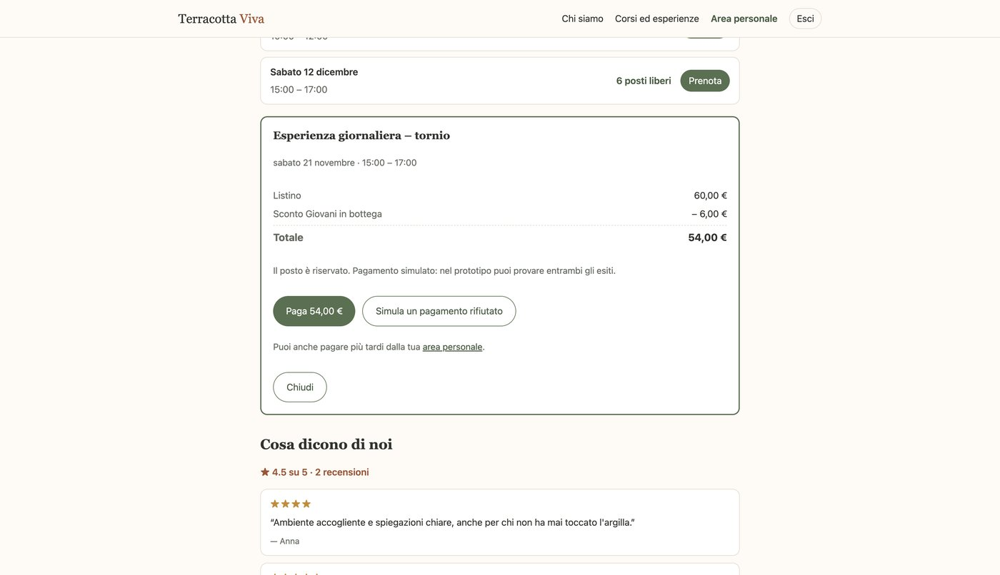
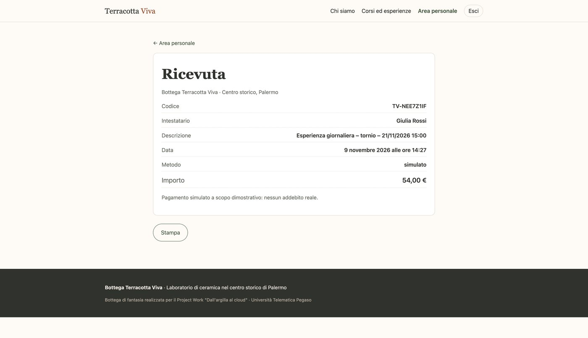

## 4. Pagamento rifiutato

**Utente:** Luca, che ha prenotato ma il cui pagamento è stato rifiutato. **Requisiti:** RF10, RF11.

**Passi**
1. Accedere come Luca e aprire l'area personale.

**Risultato atteso:** la prenotazione non è confermata: resta *da pagare*, il posto resta riservato e
il cliente può riprovare con il pulsante *Paga* oppure annullare.

**Risultato ottenuto:** come atteso. La prenotazione mostra lo stato *Da pagare* con i pulsanti *Paga*
e *Annulla* e il promemoria dei giorni mancanti; la prenotazione precedente, pagata, è *Confermata*.

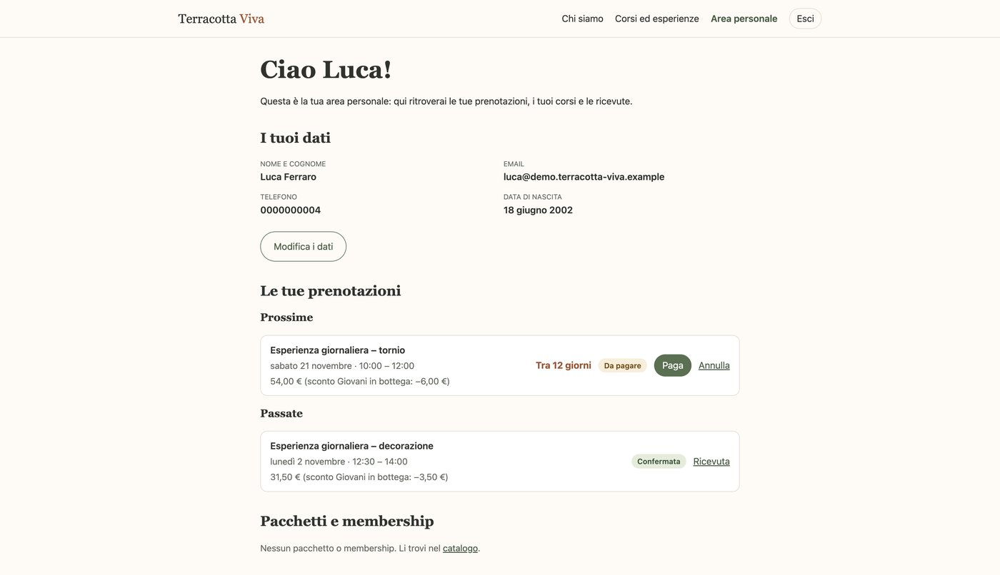

## 5. Prenotare con un pacchetto

**Utente:** Marco, che ha acquistato la *Giornata in bottega*. **Requisiti:** RF09, RB04.

**Passi**
1. Accedere come Marco e aprire l'area personale.

**Risultato atteso:** il pacchetto risulta attivo, con la ricevuta. L'esperienza al tornio prenotata
con il pacchetto è confermata senza un nuovo pagamento, e il sistema indica quale esperienza resta da
prenotare. Marco ha più di 26 anni, quindi non riceve lo sconto per i giovani.

**Risultato ottenuto:** come atteso. La prenotazione al tornio è "inclusa nel tuo pacchetto" e il
pacchetto indica "Da prenotare: Esperienza di decorazione".

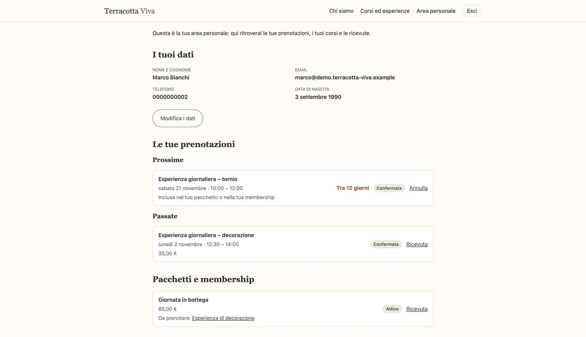

## 6. Prenotare il coworking con la membership

**Utente:** Sara, con la membership di un mese. **Requisiti:** RF09, RB06.

**Passi**
1. Accedere come Sara e aprire l'area personale.

**Risultato atteso:** la membership è attiva, con gli ingressi rimasti e la data di scadenza; il turno
di coworking prenotato ha consumato un ingresso. Il telefono, facoltativo, risulta non indicato.

**Risultato ottenuto:** come atteso. La membership mostra 7 ingressi rimasti su 8 e la scadenza a 30
giorni dal pagamento.

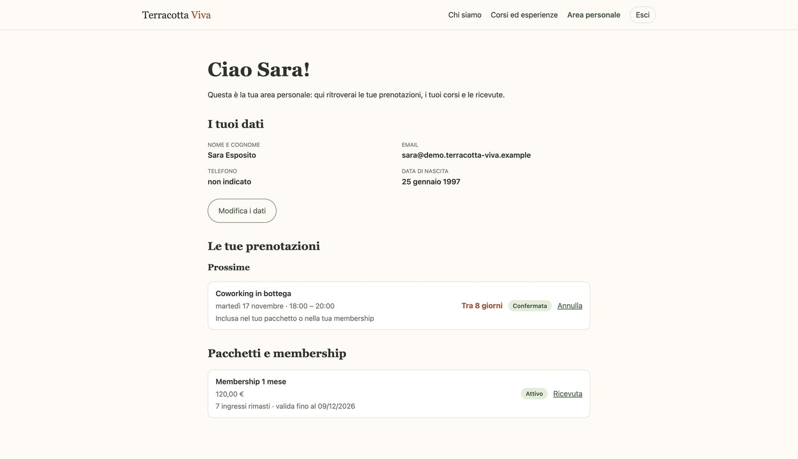

## 7. Consultare la dashboard

**Utente:** titolare. **Requisiti:** RF19.

**Passi**
1. Accedere come titolare e aprire il pannello, scheda *Andamento*.

**Risultato atteso:** gli indicatori degli ultimi trenta giorni sono calcolati dai dati reali del
sistema, compresi i pagamenti appena eseguiti.

**Risultato ottenuto:** come atteso. Incassi 760,00 € (i 706,00 € dei dati dimostrativi più i 54,00 €
pagati da Giulia nello scenario 3), 4 prenotazioni confermate, riempimento medio del 29%, 1 membership
attiva, 5 nuovi clienti, voto medio 4,5, incassi per tipologia e servizi più richiesti.

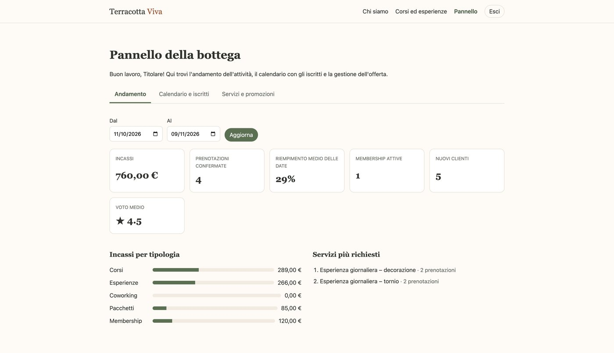

## 8. Consultare gli iscritti di una data

**Utente:** titolare. **Requisiti:** RF16, RF17.

**Passi**
1. Nel pannello, aprire la scheda *Calendario e iscritti*.
2. Premere *Iscritti* sull'esperienza al tornio di sabato 21 novembre alle 10.

**Risultato atteso:** per ogni data compaiono iscritti e posti liberi; l'elenco mostra nome, email,
telefono e stato di ogni prenotazione, così la titolare può contattare subito gli iscritti.

**Risultato ottenuto:** come atteso. La data ha 2 iscritti su 6: Marco, confermato, e Luca, da pagare,
con email e telefono cliccabili.

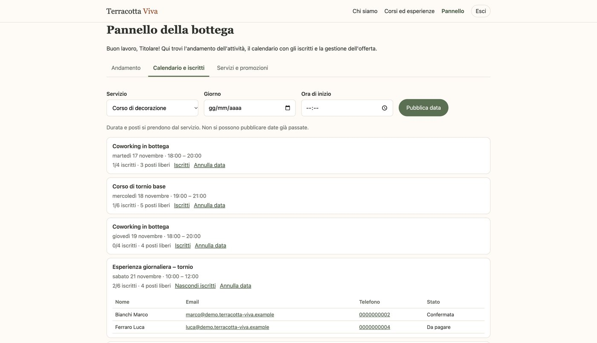

## 9. Usare il sito dallo smartphone

**Utente:** Giulia, da iPhone. **Requisiti:** RNF03 (usabilità).

**Passi**
1. Aprire il sito con Safari e accedere come Giulia.
2. Aprire l'area personale.

**Risultato atteso:** le pagine si adattano allo schermo stretto, senza zoom né scorrimento laterale.

**Risultato ottenuto:** come atteso. Il menù e i testi sono leggibili, la foto si sposta sotto il
titolo e le prenotazioni mostrano prezzo, sconto, stato e promemoria su una sola colonna.

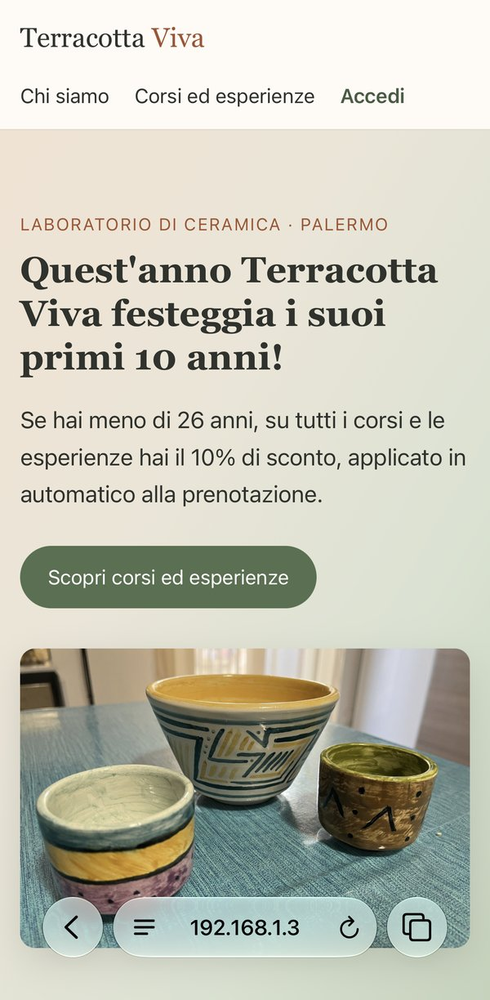 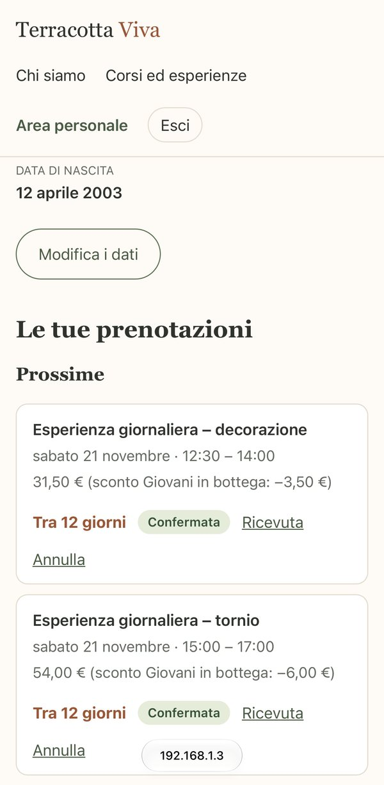
